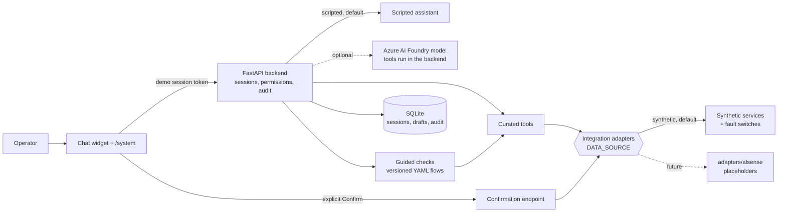

# Alsense-style operations assistant: synthetic reference starter

> **This repository runs in synthetic mode by default.** It does not connect to Alsense, submit real reports,
> create real support tickets, or contain customer operational data.

```bash
git clone https://github.com/amir0135/alsense-chat-starter.git
cd alsense-chat-starter
cp .env.example .env
docker compose up --build        # open http://127.0.0.1:8001
```

## Contents

1. [What this is](#1-what-this-is)
2. [What this is not](#2-what-this-is-not)
3. [Architecture](#3-architecture)
4. [Fastest start with Docker](#4-fastest-start-with-docker)
5. [Development start](#5-development-start)
6. [Synthetic demo scenarios](#6-synthetic-demo-scenarios)
7. [Configuration modes](#7-configuration-modes)
8. [Running tests](#8-running-tests)
9. [Resetting the demo](#9-resetting-the-demo)
10. [Adding a troubleshooting flow](#10-adding-a-troubleshooting-flow)
11. [Implementing a real adapter](#11-implementing-a-real-adapter)
12. [Security and confidentiality](#12-security-and-confidentiality)
13. [Known gaps](#13-known-gaps)
14. [Troubleshooting setup](#14-troubleshooting-setup)

For a step-by-step operator guide, read [`docs/HANDOVER.md`](docs/HANDOVER.md).

## 1. What this is

A clone-and-run reference implementation of an operations assistant for refrigeration and building sites:

- **Conversation** about permitted sites, alarms, approved guidance and reports, with cited sources.
- **Guided troubleshooting:** versioned decision trees that operations teams own, run deterministically by the
  backend, with site matching ("Do you mean Demo North?") and backend health-check lookups.
- **Reports in plain language:** "Create a temperature report for Demo North for the last seven days". The site is
  matched against the user's permitted sites (never guessed), the report type comes from the report catalog, and
  a confirmed report shows a download link with its expiry time. Reports run on demand (type, site, period, PDF,
  CSV or Excel) or on a schedule (frequency, recipients, start and optional end date).
- **Drafts, never silent actions:** reports, schedules and support requests are prepared for review; only an
  explicit confirmation submits them, and only to synthetic services.
- **A modular agent:** instructions and tools live in one folder per domain (sites, reporting, troubleshooting),
  and each request is offered only the tools of the domains it needs.
- **Explicit failures:** access denied, service unavailable, ambiguous site, no approved answer and "prepared but
  not submitted" each have their own message, and each can be switched on for a demo.
- **Trust:** a permanent synthetic-data banner, a `/system` readiness page, a "Why this result?" panel, correlation
  ids and an audit trail without tokens or free text.
- **A clear integration seam:** one interface per external service, synthetic implementations by default and
  Alsense placeholders that fail clearly until they are written.

## 2. What this is not

- Not an Alsense product or a Danfoss/LHU integration, and not connected to any Alsense system.
- Not production-ready: demo sign-in has no real authentication, SQLite is single-instance, and the reply checks
  do not prove that every sentence is entailed by a source.
- Not a container for customer material: customer flows stay in local, ignored files (section 12).

## 3. Architecture



The backend owns every data access and tool call; a model only proposes tool calls and never receives user
credentials. Details: [`docs/architecture.md`](docs/architecture.md) (an editable diagram is in
`docs/architecture.drawio`).

| Path | Contents |
|---|---|
| `src/alsense_chat/app.py` | HTTP API, sessions, confirmation endpoint, correlation ids |
| `src/alsense_chat/adapters/` | Contracts, errors, interfaces, `synthetic/` and `alsense/` implementations |
| `src/alsense_chat/agent/` | Agent modules: core instructions, then one folder per domain with its instructions and tools ([guide](src/alsense_chat/agent/README.md)) |
| `src/alsense_chat/domains/` | Site resolution, report validation and the scripted report planner |
| `src/alsense_chat/tools.py` | Tool registry, schema and permission checks, who may call each tool |
| `src/alsense_chat/flows.py` | Guided-check engine and flow validation |
| `src/alsense_chat/runner.py` | Scripted assistant and the optional Foundry runner |
| `src/alsense_chat/static/` | Chat widget, demo scenarios and the `/system` page |
| `scripts/` | `dev.py` tasks, `doctor.py`, protected-file check, fixture generator |
| `fixtures/`, `evals/` | Contract examples per integration call; behaviour evaluations ([format](evals/README.md)) |

## 4. Fastest start with Docker

Needs Docker with Compose 2.24 or newer. No Python, uv or Azure credentials.

```bash
docker compose up --build      # build and start; open http://127.0.0.1:8001
docker compose down            # stop; demo data is kept in a named volume
docker compose down -v         # stop and delete all demo data for a clean start
```

The image is pinned (uv and Python by digest) and installs the exact versions in `uv.lock` with hash checking.
It runs as a non-root user with a read-only root filesystem and publishes the port on `127.0.0.1` only.
Set `APP_PORT` in `.env` to use another host port. To demo local customer flows in Docker, copy
`compose.override.example.yaml` to `compose.override.yaml` (ignored by Git and Docker) and mount the file there.

## 5. Development start

### Dev Container

Open the folder in VS Code and choose **Reopen in Container**. The container has Python 3.12, Git and the pinned
uv 0.9.11; it installs the dependencies and runs the setup doctor. Then run the VS Code task **Start demo**
(port 8001 is forwarded) or `uv run python scripts/dev.py start`.

### Local

Needs [uv](https://docs.astral.sh/uv/); it provides Python 3.12 from `.python-version`.

```bash
uv run python scripts/dev.py setup     # pinned dependencies, .env, data folder, setup doctor
uv run python scripts/dev.py start     # http://127.0.0.1:8001  (--reload while editing)
```

`scripts/dev.py` works the same on macOS, Linux and Windows; `make setup`, `make start` and friends wrap it.
Run `uv run python scripts/dev.py --help` for every task.

Select a synthetic user and press **Start demo session**: Alice sees Demo North, Bob Demo South, Carol two sites.
Use the quick actions, ask in plain language, or use the reference commands:

```text
Create a temperature report for Demo North for the last seven days
Schedule a weekly temperature report for Demo North as Excel to operations@example.com
My sensor is offline. What should I check?
/sites *
/reports
/docs offline sensor
/flows
/flow site-connection
/report {"site_id":"site-a","report_type":"alarm-history","format":"pdf","start":"2026-01-01","end":"2026-01-31"}
/schedule {"site_id":"site-a","report_type":"temperature-log","format":"xlsx","frequency":"weekly","recipients":["operations@example.com"],"start_date":"2030-01-07"}
/ticket {"site_id":"site-a","alarm_id":"alarm-site-a","summary":"Offline sensor","steps_tried":"Checked power"}
/status <prepared-report-action-id>
```

## 6. Synthetic demo scenarios

Open **Demo scenarios** in the app. Each scenario lists what it demonstrates, the starting user and the expected
result; **Start scenario** signs in as that user (with any synthetic faults it needs) and a coach walks through
the steps. **Reset scenario** starts again from a clean conversation.

| Scenario | Shows |
|---|---|
| Alice: unreachable site | Misspelled site matched within permitted sites; backend health check finds the gateway offline |
| Bob: prepare a support request | Tree ends in a ticket; answered steps prefill a request; explicit confirmation |
| Report: prepare, edit, confirm, check status | Builder validation, replacing a draft, confirmation and the download link |
| Report: ask in plain words | Site resolved within permitted sites, type from the catalog, confirm, download link with its expiry |
| Report: schedule a weekly report | Frequency, recipients and start date; scheduled only after confirmation |
| Failure: similar site names in a report request | The assistant offers both sites and continues with the chosen one |
| Failure: ambiguous site | Two matching sites: the assistant asks instead of guessing |
| Failure: invalid date range | Caught inline in the builder and again by the backend |
| Failure: unavailable synthetic service | A failed lookup stops the check with the reason |
| Failure: support submission unavailable | "Your request was prepared but not submitted." |
| Failure: report job failed | A failed job is reported as failed |
| Failure: access to the site revoked | An upstream 403 is shown as an access problem |
| Failure: no approved answer | No invented advice when nothing approved matches |
| Failure: AI assistant unavailable | Model outage is explicit; guided checks keep working |

## 7. Configuration modes

Copy `.env.example` to `.env`; every setting there is commented and marked as every mode, synthetic, Azure-only or
secret. The defaults need no secrets.

| Mode | Settings | Notes |
|---|---|---|
| Scripted assistant (default) | `AGENT_MODE=demo` | Deterministic; exercises the real backend tools without a model |
| Azure AI Foundry | `AGENT_MODE=foundry`, `FOUNDRY_PROJECT_ENDPOINT`, `MODEL_DEPLOYMENT`, `az login` | Startup fails if a value is missing; never falls back to scripted answers |
| Synthetic data (default) | `DATA_SOURCE=synthetic` | All services synthetic; `/system` labels each one |
| Real Alsense data | `DATA_SOURCE=alsense` | Refused until the adapters are implemented (section 11) |
| Rehearse failures | `SYNTHETIC_FAULTS=api_timeout,report_failed,...` | Every session; scenarios add faults to their own session |
| Trim the demo | `ENABLE_REPORTS`, `ENABLE_TROUBLESHOOTING`, `ENABLE_SUPPORT_REQUESTS` | The UI hides what is off |
| Clean demo on start | `RESET_DEMO_DATA_ON_START=true` | Deletes `SESSION_DB` at startup |

In Foundry mode your messages and synthetic tool results go to **your** Foundry project; credentials never do.
The deployment must support the Responses API and function calling. To deploy the protected synthetic demo to
your own Azure subscription (Container Apps, Foundry, Key Vault, monitoring), follow
[`docs/azure-demo.md`](docs/azure-demo.md).

## 8. Running tests

```bash
uv run python scripts/dev.py test      # unit, API, contract-fixture and evaluation tests
uv run python scripts/dev.py lint      # ruff format and lint, mypy, widget JavaScript, protected files
uv run python scripts/dev.py evals     # behaviour cases in evals/ only, a pass/fail line per case
uv run python scripts/dev.py validate-flows [FILE ...]
```

`tests/test_scenarios.py` runs every demo scenario and checks its promised result. Each evaluation case in `evals/`
states a question, the user's sites, the expected tools, parameters, clarification and result, whether the user
must confirm, and what must never happen; [`evals/README.md`](evals/README.md) explains the format and model mode.
`fixtures/` holds an example for every integration call, generated from the synthetic adapters and checked against
the contract models.
CI (`.github/workflows/ci.yml`) also builds and smoke-tests the Docker image and the Dev Container, compiles the
Bicep and scans the full history for secrets and protected files.

## 9. Resetting the demo

| Run | Reset |
|---|---|
| Local | Stop the demo, then `uv run python scripts/dev.py reset` |
| Docker | `docker compose down -v` |
| Every start | `RESET_DEMO_DATA_ON_START=true` |
| One scenario | **Reset scenario** in the app |

## 10. Adding a troubleshooting flow

Flows are YAML decision trees owned by operations teams: `ask` (yes/no), `identify_site`, `check` (backend lookup)
and `outcome` (`resolve` or `ticket`). Every flow declares `version`, `status`, `owner` and `approved_for_demo`;
only approved flows are offered. The shipped synthetic sample is `src/alsense_chat/troubleshooting.yaml`.

1. Copy the sample's structure into a new file, for example `flows.local.yaml` for customer material.
2. Validate it: `uv run python scripts/dev.py validate-flows flows.local.yaml`. Every problem is listed at once:
   duplicate keys, unreachable nodes, loops, unknown keys, missing outcome kinds and unsupported checks.
3. Load it with `FLOWS_FILE=./flows.local.yaml` in `.env` and restart. `/system` shows the version and owner.
4. Optionally add demo scenarios for it in a `scenarios.local.yaml` loaded with `SCENARIOS_FILE`.

A synthetic flow that belongs in this public repository goes into `troubleshooting.yaml` with a scenario and
evaluation cases. Customer-provided trees and wording never do.

## 11. Implementing a real adapter

Each external capability has one interface in `src/alsense_chat/adapters/interfaces.py` (identity, site
directory, guidance search, health checks, reports, support). Implement the placeholders in
`src/alsense_chat/adapters/alsense/`, map upstream failures to `adapters/errors.py`, compare shapes with
`fixtures/`, then set `DATA_SOURCE=alsense`. [`docs/integration-map.md`](docs/integration-map.md) lists, per
component, what Alsense must provide; [`docs/integration.md`](docs/integration.md) covers authentication, delegated
tokens and the production work.

## 12. Security and confidentiality

- **Synthetic by default:** every user, site, alarm, document and result is invented, and `/system` says so.
- **No credentials to the model:** tools run in the backend; the model sees tool schemas and selected results only.
- **Permissions in code:** tenant and site checks on every lookup, draft, status read and confirmation.
- **No hidden actions:** preparing is not submitting; only the confirmation endpoint submits, idempotently.
- **Demo sign-in only:** never expose the local demo publicly. The hosted demo requires a generated access code.
- **Audit without secrets:** the audit trail stores categories, allowlisted fields and lengths of free text.
- **Customer material stays local:** `.env`, `*.local.yaml`, `compose.override.yaml`, `data/`, `.azure/` and
  customer documents are ignored by Git and kept out of Docker images and the export.
  `python3 scripts/check_protected_files.py --history` and CI fail if one is ever tracked. A `.gitignore` rule
  does not remove files committed earlier: rewrite the history or share a clean export
  (`uv run python scripts/dev.py export`, history-free, from an allowlist).

## 13. Known gaps

- Real sign-in, token validation, delegated tokens / on-behalf-of exchange: not implemented.
- Alsense adapters, Azure AI Search, APIM and explicit Content Safety integration: placeholders or future work.
- SQLite is a single-instance local store, not shared cloud storage; set retention and access rules before real use.
- Reply checks validate structure, sources, numbers, links and wording, not full factual entailment. Add the
  product's answer-quality evaluations before trusting model answers.
- The scripted assistant understands a fixed set of phrasings; free text beyond them needs the model.
- Scheduled reports can be created and checked, not listed, changed or cancelled.
- Frontend actions (operating the host application's screens) wait for the capability manifest and host contracts;
  see [`docs/integration-map.md`](docs/integration-map.md).
- Report and support forms do not calculate figures or render charts.

## 14. Troubleshooting setup

Run the doctor first; it checks Python, uv, the lock file, dependencies, configuration, mode, flows, scenarios,
database, port, a running app and tracked secrets, and ends with `Ready:` or what to fix.

```bash
uv run python scripts/doctor.py
docker compose exec app python scripts/doctor.py
```

- **Port 8001 in use:** stop the other program or set `APP_PORT`.
- **Package downloads blocked by a corporate network:** set `UV_DEFAULT_INDEX` to your mirror. Then
  `uv run --no-sync python scripts/dev.py setup`, or `docker compose up --build` with the variable set. The exact
  locked versions install with hash checking; nothing mirror-specific is written to the repository.
- **Flow file rejected:** `uv run python scripts/dev.py validate-flows <file>`.
- **Database newer than the app:** `uv run python scripts/dev.py reset`.

More symptoms and fixes: [`docs/HANDOVER.md`](docs/HANDOVER.md#diagnosing-startup-problems).
