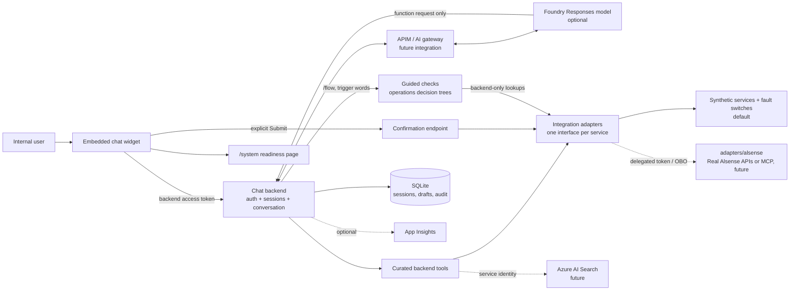

# Architecture: backend-owned tools

The key token-flow choice is to execute every tool in the backend. Foundry receives tool schemas and selected
results, never the user's credential. It does not connect directly to a hosted MCP server or an Alsense API.

For a detailed, editable version with animated request flows, open [`architecture.drawio`](architecture.drawio)
in draw.io.

## Local implementation

The widget receives an opaque demo token; the backend resolves its hash to an expiring session. The mock
`users_me` is called once at session creation. The session stores only synthetic user identity and allowed sites,
never the raw token. All authenticated endpoints enforce the backend feature flag and internal-user gate.
The widget can request permitted report types and start a fresh conversation under the same authenticated
synthetic identity; both endpoints require the existing bearer session.

Every external capability sits behind an interface in `src/alsense_chat/adapters/interfaces.py`: identity, site
directory, guidance search, health checks, reports and support. `DATA_SOURCE` selects the implementation in one
place (`build_services`). The synthetic services are the default; `adapters/alsense` holds placeholders that raise
`NotConfiguredError`, so selecting them fails at startup instead of silently falling back. Adapters raise
categorized errors (forbidden, not found, unavailable, timeout, stale, unauthenticated) whose user-safe wording the
UI shows as is. For demos, synthetic fault switches wrap the synthetic services, process-wide
(`SYNTHETIC_FAULTS`) or per scenario session; they never wrap a real integration.

Tool arguments are validated against typed schemas. Sites are filtered by both tenant and allowed-site list.
Support drafts also validate the alarm/site pair. Prepared actions belong to the session that created them.
The model cannot submit an action: submission is a different HTTP endpoint requiring explicit confirmation and
repeat authorization. Duplicate confirmations reuse the stored result.

The default runner is deterministic. Optional Foundry mode uses the Responses API with stateless model calls
(`store=false`) and a bounded local history. The backend retains the conversation, runs function calls, and
validates the final structured reply. It makes one repair attempt and then abstains.

Guided troubleshooting flows are a separate deterministic path in both modes. The backend walks an
operations-owned decision tree, identifies the site within the user's permitted sites, and runs its lookups
(for example open health checks) with the session's permissions. These lookups are not exposed as model tools.

Every request gets a correlation id (reused from a well-formed `X-Correlation-ID` header and returned in the
response). Chat, guided-check, sign-in and confirmation events are written to an audit table with the demo user,
scenario, flow id and version, tools called with their result category, allowlisted inputs (free text only as its
length), confirmation state, outcome and error category, never tokens or message text. Each reply carries a
user-safe "Why this result?" explanation built from the same facts. `/api/system` and the `/system` page report,
without secrets, which capabilities are synthetic, configured, disabled or future integrations.

SQLite supports one local instance and survives process restarts. The schema is versioned with
`PRAGMA user_version` and migrated in place at startup. It is not a shared cloud session store. A real
distributed deployment needs a store with tenant/user ownership, expiry, concurrency control, and idempotent
submission supported by the downstream API.

## Target production boundaries

The synthetic demo Bicep creates Foundry, Container Apps, Key Vault, identity and monitoring.
APIM, Search, explicit Content Safety and shared cloud storage remain integration points. Put the selected
gateway on the **backend-to-model path** without assuming it can
validate a user identity token that is deliberately not forwarded to the model. Validate user auth at the
backend's authenticated ingress or in the backend. Use a separate service identity for Foundry.

For delegated API access, validate the incoming audience and exchange the token via OBO when the downstream
audience differs. Keep the delegated credential in a request-local adapter context. API authorization remains
mandatory even after backend site filtering. Knowledge retrieval must enforce document permissions before
returning excerpts, and retrieved text must be treated as untrusted data.

Ticket creation must use the existing approved workflow only after user confirmation. A support mailbox is
not a destination the model is allowed to choose. Telemetry must not capture raw authorization headers, prompts
or results by default; the local fallback backlog stores categories.
